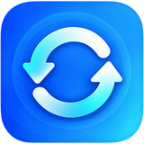

<div align="center">



# Project Sync for Acode

**Two-way folder synchronization for projects on Android.**

Keep your Acode Terminal Public projects and a second folder synchronized—whether you work on HTML, CSS, JavaScript, React, Next.js, or other source-code projects.

   

[Installation](#installation) · [Features](#features) · [Safety](#safety-first) · [FAQ](#frequently-asked-questions) · [Report an issue](https://github.com/HowdyMohsin/acode-project-sync/issues)

</div>

> **Community plugin, not an official Acode product.** Project Sync works locally with the folders you authorize in Acode. It is not cloud sync, Git sync, or a replacement for independent backups.

## Why Project Sync?

Acode's terminal project folder may not be directly writable from other Android storage tools. Project Sync uses **Acode's filesystem APIs and authorized folder access** to synchronize projects between two selected locations without moving your development workflow.

```text
Folder A — Terminal Public                 Folder B — Selected storage
/public/                                   A code/ or SD card/
├── my-website/                            ├── my-website/
│   ├── index.html                         │   ├── index.html
│   ├── css/style.css       ⇄             │   ├── css/style.css
│   └── js/app.js                           │   └── js/app.js
└── next-project/                          └── next-project/
    ├── app/                                   ├── app/
    ├── components/                            ├── components/
    └── package.json                           └── package.json
```

Changes can originate in either folder. The plugin recreates nested project paths while excluding common dependency, build, and cache directories.

## Features

| Capability | Behavior |
| --- | --- |
| **Two-way synchronization** | Copies new files and applies safe changes from Folder A to B and B to A. |
| **Project structure** | Creates nested directories and supports source files and assets, subject to the configured file-size limit. |
| **Manual + Auto** | Preview and sync on demand, or periodically scan while Acode remains active. |
| **Fast interval options** | Select a short polling interval, including 1 and 3 seconds. Actual completion time depends on the project and device. |
| **Safe first merge** | Files present in both folders at the same path but with different content are held as conflicts. |
| **Rename detection** | Recognizes certain unambiguous, unchanged-file renames; complex moves or simultaneous rename-and-edit operations may be treated as separate changes. |
| **Optional removal mirroring** | Can propagate tracked deletions only when explicitly enabled; additional safeguards apply in Auto. |
| **Private recovery** | Keeps recoverable versions in Acode WebView's private database; recover from the Recovery tab. |
| **Acode folder refresh** | Requests an editor folder-tree refresh after successful writes. |
| **Exclusions** | Skips common generated folders and sensitive/local configuration files. |
| **Local-first** | No user account, cloud storage, or server required for file synchronization. |

### Default exclusions

Directory examples: `node_modules/`, `.next/`, `.git/`, `.cache/`, `.turbo/`, `.vercel/`, `dist/`, `build/`, `out/`, `coverage/`, and other generated folders.

File examples: `.env`, `.env.*`, `.bash_history`, `.npmrc`, and temporary/log files. You can add custom exclusions in Settings. Check the implementation for the exact default list.

## Installation

### Option A — GitHub release (recommended)

1. Open the [Releases page](https://github.com/HowdyMohsin/acode-project-sync/releases).
2. Download the **`plugin.zip` asset** from a published release. Do not install GitHub's automatically generated **Source code (zip)** archive; its internal folder structure is different.
3. In Acode, open **Plugins → + → LOCAL**.
4. Select the downloaded `plugin.zip` and install it.
5. Open **Project Sync** from Acode's sidebar.

### Option B — Remote ZIP URL

Acode also supports installation from a direct ZIP URL via **Plugins → + → REMOTE**. Once a GitHub release is published, its direct `plugin.zip` download URL can be used. [Acode's installation guide](https://docs.acode.app/docs/getting-started/intro) documents the supported installation methods.

> **Before updating:** Back up important projects and recovery data. Prefer upgrading the existing plugin rather than clearing Acode's application data.

## Quick start

1. Open **Settings** in the Project Sync sidebar.
2. Pick **Folder A** (for example, *Terminal Public*) and **Folder B** (your internal storage or removable SD-card folder).
3. Use **Test access** to verify authorized read/write permissions.
4. Select **Preview changes** to review the initial merge, especially if both folders already contain projects.
5. Tap **Sync now** for the first safe sync.
6. Confirm your project files exist in both locations. Only then enable **Start auto** if needed.

**Both folders do not have to be empty.** Existing, different files at the same relative path become conflicts rather than being silently overwritten.

## How synchronization decides what to do

| Situation | Result |
| --- | --- |
| New file exists only on one side, with no tracked previous version | Copy to the other side. |
| Previously synced file was edited on one side | Update the untouched side, with recovery safeguards. |
| Both sides independently change the same file | Flag a conflict; don't silently choose a winner. |
| Same-path files differ during the first sync | Hold as a conflict for manual review. |
| File deleted on one side | **No active deletion by default.** Optional Mirror mode handles tracked removals. |
| Generated/cache directory | Exclude from synchronization. |

File operations are based on scanned content and saved synchronization state. This is a practical local project-sync tool, **not a transactional filesystem or distributed version-control system**.

## Safety first

- **Keep an independent backup**, especially before a first merge, mass rename, directory move, or turning on removal mirroring.
- Deletions are opt-in. Auto removals require an additional permission and may be limited for large batches.
- Recovery data is stored inside **Acode's WebView private storage**, not a visible folder in your projects. Uninstalling the plugin, clearing app data, or database corruption may remove recovery information. It is **not** a permanent backup system.
- Never use two folders that overlap (one inside the other); the plugin is designed to reject this configuration.
- The plugin skips common secrets such as `.env` files, but **review your custom exclusions before syncing confidential projects**.
- Android may suspend Acode. **Auto mode only operates while Acode's plugin runtime is active**. A 1-second setting is a scan scheduling interval, not a guaranteed real-time or reboot-persistent service.
- Removable SD-card access must be granted through the Acode folder picker; Android `/sdcard` generally means **internal shared storage**, not a physical SD card.

## Frequently asked questions

<details>
<summary>Can I create a project in the destination folder?</summary>

Yes. Two-way sync allows new projects from either configured location to be copied to the other, as long as Acode has access to both folders.

</details>

<details>
<summary>Does it copy node_modules or Next.js build output?</summary>

No. Common generated directories are excluded by default to keep synchronization focused on project source files. Review the exclusion list in Settings for your specific project.

</details>

<details>
<summary>Will Auto continue after Acode is force-stopped or my phone restarts?</summary>

No guaranteed background or boot-persistent service is provided. Android can stop the editor's plugin runtime. Open Acode and verify sync status after a restart.

</details>

<details>
<summary>Does this synchronize with GitHub or another cloud provider?</summary>

No. **GitHub is used to host the plugin's source and releases.** Project Sync itself synchronizes two local folders selected in Acode.

</details>

<details>
<summary>Where are deleted or overwritten versions saved?</summary>

In the **Recovery** tab, backed by Acode WebView private storage. Preserve independent backups because this data can be lost when Acode's app storage is cleared.

</details>

## Development

This repository contains the distributable plugin source and manifest:

```text
acode-project-sync/
├── main.js          # Acode plugin and synchronization engine
├── plugin.json      # Acode plugin manifest
├── icon.png         # Plugin/sidebar icon
├── readme.md        # Description for the Acode plugin registry
├── changelogs.md    # Version history / release summary
├── README.md        # This GitHub guide
├── LICENSE          # MIT license
└── plugin.zip       # Installable Acode package
```

A valid installable plugin ZIP must contain `plugin.json` and the `main` entry at the **root**. See [Acode's plugin packaging documentation](https://docs.acode.app/docs/getting-started/create-plugin) before changing the structure.

### Contributing and bug reports

Bug reports and pull requests are welcome. When reporting an issue, include your Acode version, the selected storage-provider type (internal / removable SD / terminal), the scan mode, a reproduction sequence using **disposable test files**, and Activity diagnostics. **Remove private file paths, tokens, and sensitive data** before publishing logs.

[Open an issue](https://github.com/HowdyMohsin/acode-project-sync/issues) · [View releases](https://github.com/HowdyMohsin/acode-project-sync/releases)

## Author

**Mohsin Ali** — MERN Stack Developer & JavaScript Specialist  
GitHub: [@HowdyMohsin](https://github.com/HowdyMohsin)  
Portfolio: [mohsin-ali--portfolio.vercel.app](https://mohsin-ali--portfolio.vercel.app/)

## License

Released under the **[MIT License](LICENSE)**.

---

*Project Sync for Acode is an independently developed community plugin and is not affiliated with or endorsed by Acode Foundation.*